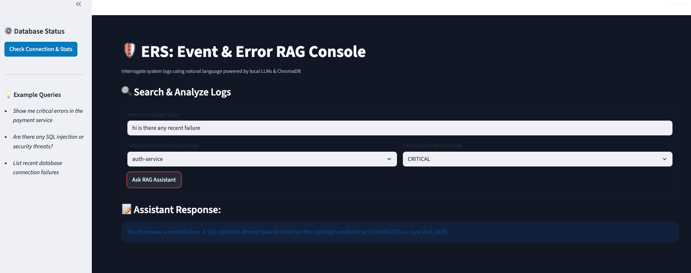

# 🛡️ ERS: Event/Error RAG System

A lightweight, local-first **RAG (Retrieval-Augmented Generation)** service built for cybersecurity logs. ERS allows developers and security teams to ingest error logs, perform precise **metadata filtering** (by service name and severity), and query logs using natural language backed by strict **anti-hallucination guardrails**.

Built with **FastAPI**, **LangChain**, **ChromaDB**, and powered completely free and offline via **Ollama**.

---

## 🚀 Key Features

* **Custom Log Parsing & Metadata Filtering:** Isolates specific log streams using structured metadata (`timestamp`, `severity`, `service_name`) to enable precise queries like *"Show me critical errors from the auth service"*.
* **100% Local & Free:** Powered by Ollama (`llama3.2` and `nomic-embed-text`) and a local ChromaDB instance—no paid cloud API keys required.
* **Anti-Hallucination Guardrails:** Implements custom prompt constraints that force the LLM to admit when logs lack enough context, preventing fabricated security vulnerabilities.
* **FastAPI REST Endpoints:** Clean API interface for asynchronous log ingestion and semantic querying.

---

## 🛠️ Tech Stack

* **Web Framework:** FastAPI & Uvicorn
* **Orchestration:** LangChain
* **Vector Database:** ChromaDB (Persistent local storage)
* **LLM & Embeddings:** Ollama (`llama3.2`, `nomic-embed-text`)
* **Validation:** Pydantic

---

## 📁 Project Structure

```text
ers/
├── chroma_db/         # Local vector database storage (auto-generated)
├── models.py          # Pydantic data models for log schema
├── vectorstore.py     # ChromaDB configuration & Ollama embeddings setup
├── main.py            # FastAPI server, metadata filtering, and RAG guardrail logic
└── README.md          # Project documentation
```

---

## ⚙️ Step-by-Step Instructions to Run

### Step 1: Ensure Ollama is Running
Make sure Ollama is running in the background on your system. You can verify it by opening your terminal and running:
```bash
ollama list
```

### Step 2: Set Up Virtual Environment & Dependencies
Open your terminal inside the project root folder and run:
```bash
# Create virtual environment
python3 -m venv venv

# Activate virtual environment
source venv/bin/activate  # On Windows use: venv\Scripts\activate

# Install required dependencies
pip install --upgrade pip
pip install -r requirements.txt
```

### Step 3: Pull Local AI Models
Download the local language model and embedding model via Ollama:
```bash
ollama pull llama3.2
ollama pull nomic-embed-text
```

### Step 4: Start the FastAPI Server
Run your FastAPI application using Python's module launcher:
```bash
python3 -m uvicorn main:app --reload
```
*(If you are on Windows and `python3` gives an error, use `python -m uvicorn main:app --reload`)*

The server will start at **`http://127.0.0.1:8000`**.


### Step 5: Start the Streamlit UI (Terminal 2)
Open a second terminal window, activate your virtual environment, and launch the user interface:
```bash
source venv/bin/activate
streamlit run app.py
```
---

## 🧪 Testing the API

You can test your project using either the interactive browser UI or your terminal.

### Option A: Interactive Browser Dashboard (Swagger UI)
1. Open your web browser and go to: **`http://127.0.0.1:8000/docs`**
2. Expand **`POST /ingest`** $\rightarrow$ Click **"Try it out"** $\rightarrow$ Paste log JSON $\rightarrow$ Click **"Execute"**.
3. Expand **`POST /query`** $\rightarrow$ Click **"Try it out"** $\rightarrow$ Enter your query and filter criteria $\rightarrow$ Click **"Execute"**.

### Option B: Using Terminal (`curl`)

**1. Ingest Sample Logs (`POST /ingest`)**
```bash
curl -X 'POST' \
  'http://127.0.0.1:8000/ingest' \
  -H 'Content-Type: application/json' \
  -d '{
  "logs": [
    {
      "timestamp": "2026-06-02T10:00:00Z",
      "severity": "CRITICAL",
      "service_name": "auth-service",
      "message": "SQL Injection attempt detected on /api/login endpoint"
    }
  ]
}'
```

**2. Query Logs with Metadata Filters (`POST /query`)**
```bash
curl -X 'POST' \
  'http://127.0.0.1:8000/query' \
  -H 'Content-Type: application/json' \
  -d '{
  "query": "Show me critical errors from the auth service",
  "service_name": "auth-service",
  "severity": "CRITICAL"
}'
```

---

## 🔍 Database Inspection Endpoints

* **Check DB Stats:** `GET /db/stats` — View total stored logs count.
* **Inspect Stored Logs:** `GET /db/inspect` — View documents and metadata stored in ChromaDB.

---

## 📝 License
Distributed under the MIT License. See `LICENSE` for more information.


